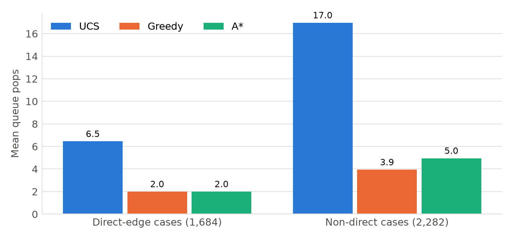
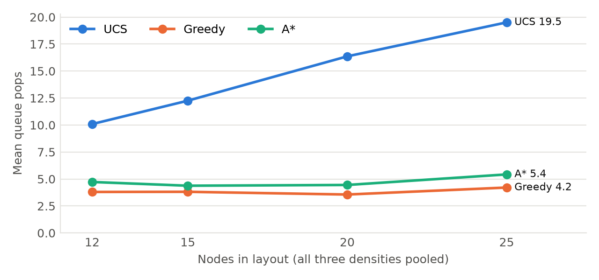
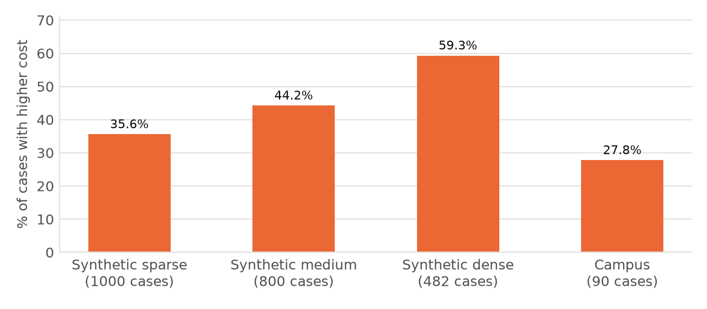
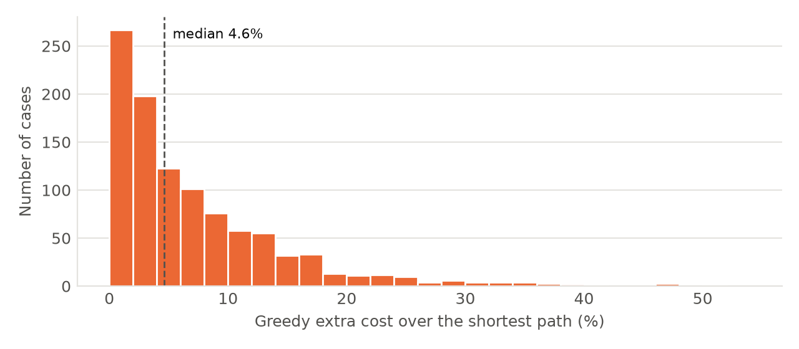
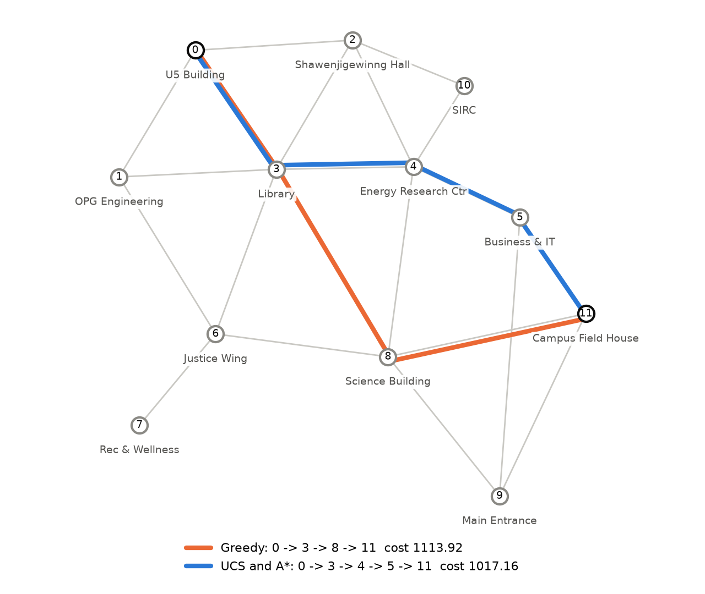

# Search Algorithm Testing and Evaluation

This folder contains the testing and evaluation results for the three search algorithms in
[`main.py`](../main.py): Uniform Cost Search (UCS), Greedy Best-First Search (Greedy) and A*.
The algorithm code and graph files were not changed for this evaluation.

## Summary

We ran every possible start/goal pair on all 13 project graphs: **4,098 cases** and 12,294 algorithm
runs. Every returned path was checked against a separate, exact shortest-path calculation.

- All 12,294 runs found a path. Every path was valid and every reported cost was correct.
- UCS and A* returned a shortest-cost path in all 4,098 cases.
- Greedy returned a higher-cost path in **996 of 2,282** synthetic non-direct cases (43.6%) and in
  25 of 90 campus non-direct cases (27.8%). It never did so when the start and goal were directly
  connected.
- On synthetic non-direct cases, mean queue pops were UCS 16.97, A* 4.96 and Greedy 3.94. A* used
  71% fewer queue pops than UCS.
- Run times were measured carefully but are indicative only. They come from one machine, each run
  takes a few microseconds, and they depend on this Python implementation.

## Contents

| File | Description |
|---|---|
| [`../run_experiments_v2.py`](../run_experiments_v2.py) | Experiment script: runs all cases, validates results, measures time |
| [`detailed_results.csv`](detailed_results.csv) | One row per algorithm run (12,294 rows) |
| [`summary_tables.csv`](summary_tables.csv) | Comparison tables T1-T9 shown below |
| [`heuristic_check.csv`](heuristic_check.csv) | Heuristic overestimate measured on each graph |
| [`run_metadata.json`](run_metadata.json) | Seed, timing settings, Python version and platform |
| [`charts/`](charts/) | Figures used in this README |

## 1. What was tested

**Algorithms.** The existing functions in `main.py`: `uniform_cost_search`, `greedy_best_first_search`
and `a_star_search`. Greedy and A* use straight-line (Euclidean) distance to the goal as the heuristic.
BFS was not part of this test.

**Synthetic dataset.** There are four node layouts (12, 15, 20 and 25 nodes), each with three
densities (sparse, medium, dense), giving 12 graph files. The three densities of a layout use the same
node positions, and each denser graph keeps all the edges of the sparser one and adds more. So these
are not 12 independent graphs. Edge weights are straight-line lengths rounded to two decimals.

**Campus graph.** The OTU campus graph (12 buildings, 21 paths) is reported separately (132 cases).

**Cases.** Every ordered start/goal pair where start and goal are different. A case is labelled
*direct* if there is an edge straight from start to goal, and *non-direct* otherwise. The first test
used only one start/goal pair per graph, and in 11 of the 12 synthetic graphs those two nodes were
directly connected. Direct cases are easy: 1,684 of the 3,966 synthetic cases (42.5%) are direct, and
in every one of them the direct edge was the shortest path. The two groups are reported separately so
that easy cases do not hide differences between the algorithms.

**Table 1. Dataset overview (ordered start/goal pairs, start != goal)**

| Graph | Dataset | Nodes | Density | Edges | Cases | Direct-edge | Non-direct |
|---|---|---|---|---|---|---|---|
| graph_12_sparse | synthetic | 12 | sparse | 21 | 132 | 42 | 90 |
| graph_12_medium | synthetic | 12 | medium | 38 | 132 | 76 | 56 |
| graph_12_dense | synthetic | 12 | dense | 60 | 132 | 120 | 12 |
| graph_15_sparse | synthetic | 15 | sparse | 30 | 210 | 60 | 150 |
| graph_15_medium | synthetic | 15 | medium | 53 | 210 | 106 | 104 |
| graph_15_dense | synthetic | 15 | dense | 75 | 210 | 150 | 60 |
| graph_20_sparse | synthetic | 20 | sparse | 50 | 380 | 100 | 280 |
| graph_20_medium | synthetic | 20 | medium | 78 | 380 | 156 | 224 |
| graph_20_dense | synthetic | 20 | dense | 121 | 380 | 242 | 138 |
| graph_25_sparse | synthetic | 25 | sparse | 60 | 600 | 120 | 480 |
| graph_25_medium | synthetic | 25 | medium | 92 | 600 | 184 | 416 |
| graph_25_dense | synthetic | 25 | dense | 164 | 600 | 328 | 272 |
| graph_otu_real | campus | 12 | real | 21 | 132 | 42 | 90 |
| All synthetic | synthetic |  |  | 842 | 3966 | 1684 | 2282 |

*The 12 synthetic graphs are 4 node layouts (12, 15, 20, 25 nodes) x 3 densities. The three densities of one layout share identical node positions; denser graphs add edges.*

## 2. How results were checked and measured

**Independent check.** For each graph, all true shortest-path costs were computed with the
Floyd-Warshall algorithm, using exact fractions so there is no rounding error. This check does not
share any code with the algorithms being tested. For every run, the script checks that:

- the path starts and ends at the right nodes,
- it uses only real edges and does not repeat a node,
- the reported cost equals the sum of its edge weights.

It also records whether that cost equals the true shortest cost.

**Queue pops (the "nodes explored" number).** `main.py` adds one each time an item is removed from the
priority queue. That count includes the goal itself and old duplicate entries, so it is reported here
as *queue pops*. Actual node expansions were also counted without changing the algorithm code: the
script passes in an adjacency dictionary that records each neighbour lookup.

**Timing.** Timing is measured separately from the correctness run, as follows:

- **Warm-up:** before timing each graph, the first 20 cases are run untimed.
- **Repeats:** each algorithm is timed 7 times per case, and each timing covers 50 calls in a row,
  because a single call takes only a few microseconds.
- **Fair order:** the order of the three algorithms is shuffled for every repeat using a fixed random
  seed (2026), so no algorithm always goes first.
- **Garbage collector:** Python's garbage collector is turned off during timing.

The tables report the median of the 7 repeats, with the interquartile range (IQR) as the spread.

**Table 2. Validation against an independent exact shortest-path calculation (Floyd-Warshall)**

| Dataset | Algorithm | Cases | Path found | Path valid | Reported cost correct | Cost = true shortest |
|---|---|---|---|---|---|---|
| synthetic | UCS | 3966 | 3966 | 3966 | 3966 | 3966 |
| synthetic | Greedy | 3966 | 3966 | 3966 | 3966 | 2970 |
| synthetic | A\* | 3966 | 3966 | 3966 | 3966 | 3966 |
| campus | UCS | 132 | 132 | 132 | 132 | 132 |
| campus | Greedy | 132 | 132 | 132 | 132 | 107 |
| campus | A\* | 132 | 132 | 132 | 132 | 132 |

*Path valid = starts at start, ends at goal, uses only real edges, no repeated node. Costs compared exactly using fractions, not floating point.*

## 3. Results

### 3.1 Path quality and search effort

**Table 3. Main comparison by dataset and case type**

| Dataset | Case type | Algorithm | Cases | Shortest-cost paths | % shortest | Mean queue pops | Median queue pops | Mean distinct nodes expanded |
|---|---|---|---|---|---|---|---|---|
| synthetic | direct | UCS | 1684 | 1684 | 100.0 | 6.45 | 6.0 | 5.45 |
| synthetic | direct | Greedy | 1684 | 1684 | 100.0 | 2.00 | 2.0 | 1.00 |
| synthetic | direct | A\* | 1684 | 1684 | 100.0 | 2.00 | 2.0 | 1.00 |
| synthetic | non-direct | UCS | 2282 | 2282 | 100.0 | 16.97 | 16.0 | 13.94 |
| synthetic | non-direct | Greedy | 2282 | 1286 | 56.4 | 3.94 | 3.0 | 2.94 |
| synthetic | non-direct | A\* | 2282 | 2282 | 100.0 | 4.96 | 4.0 | 3.87 |
| campus | direct | UCS | 42 | 42 | 100.0 | 3.57 | 3.0 | 2.57 |
| campus | direct | Greedy | 42 | 42 | 100.0 | 2.00 | 2.0 | 1.00 |
| campus | direct | A\* | 42 | 42 | 100.0 | 2.00 | 2.0 | 1.00 |
| campus | non-direct | UCS | 90 | 90 | 100.0 | 8.87 | 9.0 | 7.60 |
| campus | non-direct | Greedy | 90 | 65 | 72.2 | 3.49 | 3.0 | 2.49 |
| campus | non-direct | A\* | 90 | 90 | 100.0 | 3.62 | 3.0 | 2.62 |

*Queue pops = the existing 'nodes explored' counter in main.py: every item removed from the priority queue, including the goal and any outdated duplicate entries.*



*Figure 1. Mean queue pops on the synthetic graphs. In direct-edge cases, Greedy and A* stop after
about two pops, while UCS continues until it removes the goal from the queue.*



*Figure 2. Mean queue pops in synthetic non-direct cases by layout size. UCS queue pops grow with graph
size much faster than those of Greedy and A*.*

UCS and A* always found the shortest path. A* needed far fewer queue pops than UCS because the
straight-line heuristic guides it toward the goal. Greedy used the fewest queue pops, but it often
accepted a longer route. The campus graph shows the same pattern: mean queue pops on non-direct cases
were UCS 8.87, A* 3.62 and Greedy 3.49.

### 3.2 Greedy path cost

**Table 4. How much more Greedy paid when it missed the shortest path**

| Dataset | Case type | Cases | Higher-cost cases | % higher-cost | Mean extra cost % | Median extra cost % | Max extra cost % |
|---|---|---|---|---|---|---|---|
| synthetic | direct | 1684 | 0 | 0.0 | - | - | - |
| synthetic | non-direct | 2282 | 996 | 43.6 | 7.01 | 4.53 | 52.0 |
| campus | direct | 42 | 0 | 0.0 | - | - | - |
| campus | non-direct | 90 | 25 | 27.8 | 11.43 | 9.51 | 47.91 |

*Extra cost % = (Greedy cost - shortest cost) / shortest cost x 100, over higher-cost cases only.*



*Figure 3. Share of non-direct cases where Greedy returned a path costing more than the shortest path.*



*Figure 4. Extra cost Greedy paid in the 1,021 cases (synthetic and campus) where it missed the
shortest path. Most misses cost a few percent extra, but some were large.*

The worst synthetic case was `graph_20_medium` from node 18 to 15. Greedy took 18 -> 19 -> 15
(cost 678.88) instead of 18 -> 7 -> 15 (cost 446.64), which is 52.0% more.

### 3.3 By density and by layout size

**Table 5. Synthetic non-direct cases by density**

| Density | Cases | UCS mean pops | Greedy mean pops | A\* mean pops | Greedy higher-cost cases | Greedy % higher-cost |
|---|---|---|---|---|---|---|
| sparse | 1000 | 15.00 | 4.75 | 6.26 | 356 | 35.6 |
| medium | 800 | 17.23 | 3.49 | 4.36 | 354 | 44.2 |
| dense | 482 | 20.65 | 3.01 | 3.24 | 286 | 59.3 |

**Table 6. Synthetic non-direct cases by layout nodes**

| Layout nodes | Cases | UCS mean pops | Greedy mean pops | A\* mean pops | Greedy higher-cost cases | Greedy % higher-cost |
|---|---|---|---|---|---|---|
| 12 | 158 | 10.09 | 3.80 | 4.72 | 81 | 51.3 |
| 15 | 314 | 12.25 | 3.81 | 4.38 | 122 | 38.9 |
| 20 | 642 | 16.36 | 3.56 | 4.45 | 315 | 49.1 |
| 25 | 1168 | 19.51 | 4.21 | 5.42 | 478 | 40.9 |

**Density.** In sparse graphs, Greedy and A* removed more items from the queue (Greedy 4.75 compared
with 3.01 in dense graphs), because sparse graphs offer fewer edges toward the goal. Greedy's rate of
higher-cost paths went the other way: 35.6% in sparse, 44.2% in medium and 59.3% in dense graphs. A
likely reason is that in a dense graph most nearby pairs are directly connected. The remaining
non-direct pairs (482 cases) are then the harder, longer ones with many possible routes. This
explanation was not tested separately.

**Layout size.** UCS queue pops grew steadily with graph size, while Greedy and A* stayed nearly flat.
Greedy's higher-cost rate did not follow a clear size trend (51.3%, 38.9%, 49.1% and 40.9% for 12, 15,
20 and 25 nodes). These patterns come from only four layouts, so they are observations about this
dataset, not general rules.

### 3.4 What the queue-pop count contains

**Table 7. What the queue-pop count contains (non-direct cases)**

| Dataset | Algorithm | Mean queue pops | Mean expansions | Mean distinct expanded | Mean skipped outdated pops | Mean repeat expansions | Cases with skipped pops | Cases with repeat expansions |
|---|---|---|---|---|---|---|---|---|
| synthetic | UCS | 16.973 | 13.945 | 13.945 | 2.028 | 0.000 | 1545 | 0 |
| synthetic | Greedy | 3.942 | 2.942 | 2.942 | 0.000 | 0.000 | 0 | 0 |
| synthetic | A\* | 4.955 | 3.955 | 3.868 | 0.000 | 0.088 | 0 | 123 |
| campus | UCS | 8.867 | 7.600 | 7.600 | 0.267 | 0.000 | 24 | 0 |
| campus | Greedy | 3.489 | 2.489 | 2.489 | 0.000 | 0.000 | 0 | 0 |
| campus | A\* | 3.622 | 2.622 | 2.622 | 0.000 | 0.000 | 0 | 0 |

*queue pops = expansions + skipped outdated pops + 1 goal pop. UCS skips outdated entries but still counts them. A\* has no skip check, so outdated entries are expanded again (repeat expansions).*

Queue pops are close to, but not the same as, the actual work done:

- **UCS** removed outdated entries in 1,569 cases. It skips them but still counts them.
- **A\*** expanded the same node a second time in 123 cases.
- **Greedy** never has outdated entries, because it marks nodes as visited when they are added to the
  queue.

### 3.5 Run time (indicative only)

**Table 8. Measured run time per call on one machine (indicative only)**

| Dataset | Case type | Algorithm | Cases | Median time (us) | Median spread IQR (us) |
|---|---|---|---|---|---|
| synthetic | direct | UCS | 1684 | 11.66 | 0.456 |
| synthetic | direct | Greedy | 1684 | 8.93 | 0.341 |
| synthetic | direct | A\* | 1684 | 10.37 | 0.325 |
| synthetic | non-direct | UCS | 2282 | 21.92 | 0.978 |
| synthetic | non-direct | Greedy | 2282 | 14.26 | 0.619 |
| synthetic | non-direct | A\* | 2282 | 15.73 | 0.607 |
| campus | direct | UCS | 42 | 5.48 | 0.162 |
| campus | direct | Greedy | 42 | 5.34 | 0.151 |
| campus | direct | A\* | 42 | 5.67 | 0.102 |
| campus | non-direct | UCS | 90 | 9.76 | 0.379 |
| campus | non-direct | Greedy | 90 | 9.14 | 0.352 |
| campus | non-direct | A\* | 90 | 8.74 | 0.282 |

*Each case: 7 timed batches x 50 calls per algorithm, algorithm order shuffled each batch (seed 2026), after warm-up runs, garbage collector off. Python 3.12.10 on Windows-11-10.0.26200-SP0.*

These times come from one Windows machine running Python, and every call takes only a few
microseconds. They agree with the queue-pop results (UCS is slowest on non-direct cases), but the
differences between Greedy and A* are small. They should not be used to claim that one algorithm is
faster in general. Re-running the script will give slightly different times.

## 4. Representative example (campus graph)

From **U5 Building** (node 0) to **Campus Field House** (node 11). This example is typical: Greedy's
extra cost here is 9.51%, which is the median of the 25 campus cases where Greedy missed the shortest
path.



*Figure 5. Campus graph with the two routes. Node positions are the map coordinates in
`graph_otu_real.json`.*

| Algorithm | Path | Cost | Queue pops | Shortest? |
|---|---|---|---|---|
| UCS | 0 -> 3 -> 4 -> 5 -> 11 | 1017.16 | 11 | yes |
| Greedy | 0 -> 3 -> 8 -> 11 | 1113.92 | 4 | no |
| A* | 0 -> 3 -> 4 -> 5 -> 11 | 1017.16 | 5 | yes |

Greedy always expands the queued node that is closest to the goal in a straight line, and it never
considers the distance already travelled. Both routes start U5 -> Library (284.30). From the Library,
Greedy heads for the Science Building because it is closer to the Field House in a straight line, but
that route costs 829.62 from the Library. UCS and A* go through the Energy Research Centre and
Business & IT, which costs 732.86 from the Library, 96.76 less. A* found this route with 5 queue pops,
while UCS needed 11.

## 5. Issues found in the algorithm code (not changed)

`main.py` was left unchanged. These points are for discussion within the team:

- **Heuristic rounding.** Edge weights are rounded to two decimals, but the heuristic uses the exact
  straight-line length. On 440 of 863 edges, the rounded weight is slightly shorter than the
  straight line, so the heuristic can be too high by up to 0.0049 (Table 9). Strictly speaking, the
  heuristic is therefore neither admissible nor consistent on these files.

  A* still returned shortest paths here, because the error is below 0.005, every path cost is a
  multiple of 0.01, and A* in `main.py` re-opens nodes when it finds a cheaper route. That is a
  property of these files, not a general guarantee. Rounding weights *up* in the generator, or keeping
  unrounded weights, would remove the issue.
- **A\* does not skip outdated queue entries.** It has no "already found a cheaper route" check, so it
  expanded nodes a second time in 123 cases. The results were still correct, but the work was wasted
  and the queue-pop count is slightly higher.
- **UCS counts the outdated entries it skips.** The counter is increased before the skip check, so
  "nodes explored" for UCS includes entries that did no work (Table 7).
- **Greedy cost lookup.** If an edge were missing, the cost calculation would silently use 1.0
  instead of reporting an error. This never happened in these tests (all paths were valid).
- **A\* start priority.** The start node is added with priority 0 instead of its heuristic value.
  This does not change any results.
- **"Best algorithm" message.** `main()` picks the lowest cost, then the fewest queue pops, so it
  names Greedy as best whenever start and goal are directly connected. This message should not be
  read as a general ranking.

## 6. Limitations

- The graphs are small (12 to 25 nodes), and there are only four synthetic node layouts, so there is
  little variety.
- Edge weights are almost exactly straight-line distances, which makes the Euclidean heuristic very
  accurate. A* and Greedy would likely do worse on graphs where roads bend or have different speeds.
- All graphs are undirected and connected, so finding a path in every case was expected.
- Queue pops count queue operations, not all the work done. For example, A* also computes a square
  root for each neighbour it adds.
- Timing comes from one machine and one Python version, and each run is very short. It does not
  support general speed claims.
- A* returning the shortest path in every case here does not prove that A* is always optimal with
  this heuristic (see the rounding issue in Section 5).

## 7. Remaining work

- Generate more layouts (more random seeds) and larger graphs, and repeat the same tests.
- Add graphs where edge weights are larger than straight-line distance (detours), so that the
  heuristic is less accurate.
- Agree as a team on fixing the A* outdated-entry check and the weight rounding, then re-run this
  script to confirm the results and see how queue pops change.
- Include BFS in the all-pairs test as a baseline.
- Repeat the timing on a second machine to see whether the pattern holds.

## Reproducing the results

Requires Python 3 and the standard library only. From the `group9_graphs` folder:

```bash
python run_experiments_v2.py
```

This takes about one minute. It reruns all 4,098 cases and rewrites `testing_package/detailed_results.csv`,
`testing_package/heuristic_check.csv` and `testing_package/run_metadata.json`. Paths, costs, queue pops
and validation columns are deterministic and should match the committed files exactly. Timing columns
(`time_median_us`, `time_min_us`, `time_iqr_us`) and the date, Python version and platform in
`run_metadata.json` depend on the machine and will differ.

`summary_tables.csv` and the charts were produced from `detailed_results.csv`. The plotting script used
for them is not part of this folder, but every value in them can be recomputed from the columns of
`detailed_results.csv`.

### Columns in `detailed_results.csv`

| Column | Meaning |
|---|---|
| `dataset`, `graph`, `layout_nodes`, `density` | Which graph the case comes from |
| `start`, `goal`, `start_label`, `goal_label` | The case (labels are building names on the campus graph) |
| `case_type` | `direct` if a start-goal edge exists, otherwise `non-direct` |
| `algorithm` | `UCS`, `Greedy` or `A*` |
| `found`, `path`, `path_edges` | Whether a path was returned, the path, and its number of edges |
| `reported_cost` | Cost returned by `main.py` (rounded to 2 decimals) |
| `exact_path_cost`, `optimal_cost` | Exact cost of the returned path and the true shortest cost (Floyd-Warshall) |
| `path_valid`, `reported_cost_correct`, `is_optimal` | Validation results |
| `cost_gap`, `cost_gap_pct` | Extra cost over the shortest path |
| `queue_pops` | The `nodes_explored` value returned by `main.py` |
| `expansions`, `distinct_nodes_expanded` | Neighbour lookups made, and how many different nodes they covered |
| `pops_not_expanded`, `repeat_expansions` | Skipped outdated entries, and repeated expansions |
| `time_median_us`, `time_min_us`, `time_iqr_us` | Time per call in microseconds: median, minimum and IQR of 7 repeats |
