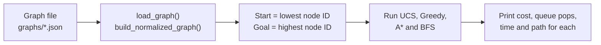
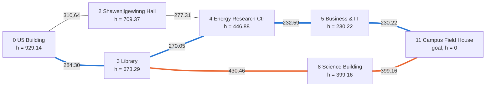

# Introtoaiprojectgrp09

**Intelligent route planning with classical search algorithms**: an Intro to AI course project
(SOFE 3720, Group 9).

The project models a map as a weighted graph and finds a route between two locations with four
search algorithms: Uniform Cost Search, Greedy Best-First Search, A* and Breadth-First Search. It
includes a graph of the Ontario Tech University (OTU) campus, 12 generated test graphs, and a
testing package that checks every route the algorithms return.

## Contents

1. [Project overview](#1-project-overview)
2. [How the system works](#2-how-the-system-works)
3. [Implemented algorithms](#3-implemented-algorithms)
4. [Project structure](#4-project-structure)
5. [Setup and usage](#5-setup-and-usage)
6. [Example output](#6-example-output)
7. [Testing and evaluation](#7-testing-and-evaluation)
8. [Key results](#8-key-results)
9. [Limitations and next steps](#9-limitations-and-next-steps)
10. [Reproducing the experiments](#10-reproducing-the-experiments)

---

## 1. Project overview

**The problem.** Given a map of locations connected by paths of known length, find a route from a
start location to a goal location. A good route should be cheap (short), and the search for it
should be efficient (it should not examine more of the map than necessary).

**The approach.** The map is stored as a graph, and route finding is treated as a *search problem*:
the program begins at the start location and explores outward until it reaches the goal. Different
search strategies decide differently which location to explore next. That choice determines both the
cost of the route found and the amount of work done.

**Educational purpose.** The project compares uninformed search, which uses no knowledge of where the
goal is, with informed search, which uses an estimate of the remaining distance. It shows in practice
the trade-offs taught in the course:

- whether an algorithm is guaranteed to find the cheapest route,
- how much of the graph it explores,
- how a heuristic (an estimate of the remaining distance) changes its behaviour.

The project has three parts:

| Part | What it provides |
|---|---|
| Environment | A real 12-building OTU campus graph and a generator for synthetic test graphs |
| Search algorithms | UCS, Greedy Best-First, A* and a BFS baseline, run from one command |
| Testing and evaluation | All-pairs experiments, independent validation of every path, and measured results |

## 2. How the system works

### Graph terms

| Term | Meaning in this project |
|---|---|
| **Node** | A location, such as a campus building. Each node has an ID (`"0"`, `"1"`, ...) and an *(x, y)* position. |
| **Edge** | A direct path between two nodes. All edges can be travelled in both directions. |
| **Weight** | The cost of travelling an edge. Here it is the straight-line length of the edge, rounded to two decimals. |
| **Start / goal state** | The node where the search begins and the node it must reach. |
| **Path cost, g(n)** | The total weight of the edges travelled from the start to node *n*. |
| **Heuristic, h(n)** | An estimate of the remaining cost from node *n* to the goal. |

The heuristic used by Greedy and A* is the **Euclidean (straight-line) distance** from a node to the
goal:

```
h(n) = sqrt((x_n - x_goal)^2 + (y_n - y_goal)^2)
```

No route can be shorter than a straight line, so this is a natural lower-bound estimate of the
remaining cost. (A rounding detail in the stored weights affects this guarantee slightly; see
[Section 9](#9-limitations-and-next-steps).)

### Program flow



Each graph file stores node positions and a weighted adjacency list (each node's neighbours and edge
weights). `main.py` loads the file, converts it to a common internal format, runs the four
algorithms on one start/goal pair, and prints a comparison.

### A small route example

The diagram shows part of the campus graph (7 of the 12 buildings and selected paths between them). Edge labels are the actual edge weights from
`graphs/graph_otu_real.json`. Each node also shows *h*, its straight-line distance to the goal,
Campus Field House (node 11).



*Blue: the cheapest route, 0 → 3 → 4 → 5 → 11, total cost 1017.16. Orange: the route Greedy
chooses after the Library, 0 → 3 → 8 → 11, total cost 1113.92. The edge 0 → 3 is on both routes.
The layout is schematic; [Figure 1](#6-example-output) shows the real positions.*

At the Library, the search has two main options:

| Next node | Path cost so far, g | Straight-line estimate, h | g + h |
|---|---|---|---|
| 8 Science Building | 284.30 + 430.46 = 714.76 | 399.16 | 1113.92 |
| 4 Energy Research Ctr | 284.30 + 270.05 = 554.35 | 446.88 | 1001.23 |

- **Greedy** looks only at *h*. The Science Building looks closer to the goal (399.16 < 446.88), so
  Greedy goes there, even though the route through it is more expensive.
- **A\*** looks at *g + h*. The Energy Research Centre has the lower total (1001.23 < 1113.92), so
  A* continues that way and finds the cheaper route.

## 3. Implemented algorithms

All four algorithms are in [`main.py`](Downloads/New%20Folder%20With%20Items/Intro%20to%20Ai%20project%20Repo/group9_graphs/main.py).
UCS, Greedy and A* keep a **priority queue**: a list of discovered nodes ordered by a score. At each
step they remove the node with the lowest score. Removing an item from the queue is called a **queue
pop**. Looking up a node's neighbours and adding them to the queue is called **expanding** the node.

| Algorithm | Picks the next node with the lowest... | Uses the heuristic? | Theoretical guarantee | What our implementation and tests showed |
|---|---|---|---|---|
| **Uniform Cost Search (UCS)** | path cost so far, *g(n)* | No | Finds a cheapest route when all weights are non-negative | Cheapest route in all 4,098 test cases; the most queue pops |
| **Greedy Best-First** | straight-line estimate, *h(n)* | Yes | Finds a route in a finite connected graph, but not necessarily the cheapest | More expensive route in 43.6% of synthetic and 27.8% of campus non-direct cases; the fewest queue pops |
| **A\*** | *f(n) = g(n) + h(n)* | Yes | Finds a cheapest route if *h* never overestimates the true remaining cost (*admissible*) | Cheapest route in all 4,098 cases, with far fewer queue pops than UCS. *h* can overestimate by up to 0.0049 here, so this result is specific to these files (see [Section 9](#9-limitations-and-next-steps)) |
| **BFS (baseline)** | number of edges from the start (first in, first out) | No | Finds a route with the fewest edges, ignoring weights | Run by `main.py` for comparison only; not part of the all-pairs evaluation |

Implementation notes:

- **Queue pops vs expansions.** The "Explored" number printed by `main.py` counts queue pops, not
  distinct nodes. It includes the goal and any outdated duplicate entries.
- **UCS** skips outdated queue entries (entries for a node that was later reached more cheaply), but
  it counts them before skipping.
- **A\*** has no skip check. It can expand the same node again, and it re-opens nodes when it finds a
  cheaper route.
- **Greedy** marks nodes as visited when they are added to the queue, so it never re-expands a node.

## 4. Project structure

Project files are inside `Downloads/New Folder With Items/Intro to Ai project Repo/`. That folder name
comes from how the project was uploaded.

```
Introtoaiprojectgrp09/
├── README.md                      Project documentation (this file)
└── Downloads/New Folder With Items/Intro to Ai project Repo/
    ├── graph_generator.py         Copy of group9_graphs/graph_generator.py
    └── group9_graphs/             Working folder: run all commands from here
        ├── main.py                Graph loading and the four search algorithms
        ├── graph_generator.py     Campus graph definition and synthetic graph generator
        ├── run_experiments_v2.py  All-pairs testing and evaluation script
        ├── graphs/                13 graph files (JSON)
        │   ├── graph_otu_real.json         OTU campus, 12 buildings, 21 paths
        │   └── graph_{12,15,20,25}_{sparse,medium,dense}.json
        ├── graph_images/
        │   └── all_graphs.png     Drawing of all 13 graphs
        └── testing_package/       Experiment results and detailed testing documentation
            ├── README.md          Full testing method, tables and findings
            ├── detailed_results.csv, summary_tables.csv,
            │   heuristic_check.csv, run_metadata.json
            └── charts/            Result charts (PNG)
```

**Graph files.** The synthetic graphs come from four node layouts (12, 15, 20 and 25 nodes), each
with three edge densities (sparse, medium, dense). The densities of a layout share the same node
positions, and each denser graph keeps all the edges of the sparser one. The campus graph also stores
building names. [`all_graphs.png`](Downloads/New%20Folder%20With%20Items/Intro%20to%20Ai%20project%20Repo/group9_graphs/graph_images/all_graphs.png)
shows all 13 graphs.

## 5. Setup and usage

### Requirements

- Python 3. The project was tested with Python 3.12.10 on Windows 11.
- `main.py` and `run_experiments_v2.py` use only the Python standard library, so no packages need to
  be installed.
- `graph_generator.py`, when run directly, needs `matplotlib`. You do not need to run it: the graph
  files are already in `graphs/`, and running it rewrites the files in `graphs/` and `graph_images/`.

### Run the program

All commands must be run from the `group9_graphs` folder, because `main.py` looks for graphs in a
`graphs/` folder relative to where it is run.

```bash
git clone https://github.com/h10khxn/Introtoaiprojectgrp09.git
cd "Introtoaiprojectgrp09/Downloads/New Folder With Items/Intro to Ai project Repo/group9_graphs"
python main.py graph_otu_real.json
```

On macOS or Linux, use `python3` if `python` is not available.

### Choose a graph

Pass a graph file name as the only argument. The `graphs/` prefix is optional.

```bash
python main.py graph_otu_real.json         # OTU campus graph
python main.py graph_12_sparse.json        # a synthetic graph
python main.py graphs/graph_20_dense.json  # the prefix also works
python main.py                             # no argument: uses graph_25_sparse.json
```

Available graphs: `graph_otu_real.json`, and `graph_N_D.json` where N is 12, 15, 20 or 25 and D is
`sparse`, `medium` or `dense`. If the file is not found, the program prints
`Error: Could not find graph file at 'graphs/<name>'.`

### How the start and goal are chosen

`main.py` has no option for choosing the start and goal. It sorts the node IDs numerically and uses:

- **start:** the lowest ID (always `0`)
- **goal:** the highest ID (`11` for the campus graph, `24` for the 25-node graphs)

There is no graphical interface; output is printed to the terminal. To compare the algorithms on
every start/goal pair, use the testing script described in [Section 10](#10-reproducing-the-experiments).

## 6. Example output

Running `python main.py graph_otu_real.json` searches from **U5 Building (0)** to **Campus Field
House (11)**:

```
Start State: '0' | Goal State: '11'

Algorithm                | Cost       | Explored   | Time (ms)  | Found?
------------------------------------------------------------------------
Uniform Cost Search      | 1017.16    | 11         | 0.020      | True
Greedy Best-First        | 1113.92    | 4          | 0.025      | True
A* Search                | 1017.16    | 5          | 0.013      | True
BFS (Baseline)           | 1113.92    | 12         | 0.013      | True

--- Found Paths ---
 -> Uniform Cost Search : 0 -> 3 -> 4 -> 5 -> 11
 -> Greedy Best-First   : 0 -> 3 -> 8 -> 11
 -> A* Search           : 0 -> 3 -> 4 -> 5 -> 11
 -> BFS (Baseline)      : 0 -> 3 -> 8 -> 11

 BEST ALGORITHM FOR THIS DATASET: A* Search
 Optimal Cost: 1017.16 | Nodes Explored: 5
```

The graph header and separator lines are omitted. **Time (ms)** comes from one run and changes every time.

What the output means:

- **UCS and A\*** both find the cheapest route, U5 → Library → Energy Research Ctr → Business & IT →
  Field House, with cost 1017.16. A* needs 5 queue pops and UCS needs 11, because A* is guided toward
  the goal.
- **Greedy** goes U5 → Library → Science Building → Field House with only 4 queue pops. That route
  costs 1113.92, which is 96.76 (9.5%) more than the cheapest route.
- **BFS** finds the same 3-edge route as Greedy. BFS minimises the number of edges, not the cost.
- **"Best algorithm"** is chosen by lowest cost, then fewest queue pops. It describes this one
  start/goal pair only; it is not a general ranking.


*Figure 1. The campus graph at its real coordinates, showing Greedy's route (orange) and the
UCS/A\* route (blue). The extra cost of Greedy's route in this example equals the median of the 25
campus cases where Greedy missed the cheapest route.*

## 7. Testing and evaluation

The original program tests one start/goal pair per graph. In 11 of the 12 synthetic graphs, that pair
is joined by a single edge, which makes the test too easy to tell the algorithms apart. To evaluate
the algorithms properly, we built
[`run_experiments_v2.py`](Downloads/New%20Folder%20With%20Items/Intro%20to%20Ai%20project%20Repo/group9_graphs/run_experiments_v2.py).
It calls the existing functions in `main.py` without changing them. All the work below is completed;
planned work is listed in [Section 9](#9-limitations-and-next-steps).

| Part of the evaluation | What was done |
|---|---|
| **Coverage** | Every ordered start/goal pair (start ≠ goal) on all 13 graphs: 3,966 synthetic cases and 132 campus cases, a total of 4,098 cases and 12,294 algorithm runs (UCS, Greedy and A*). |
| **Independent validation** | True shortest-path costs were computed with the Floyd–Warshall algorithm using exact fractions, which shares no code with the algorithms being tested. Every returned path was checked: correct start and goal, only real edges, no repeated node, correct reported cost, and whether the cost is the true minimum. |
| **Direct vs non-direct cases** | A case is *direct* if an edge joins the start and goal. In all 1,684 direct synthetic cases (42.5%), that single edge is the cheapest route, so these cases are easy. Results are reported separately for direct and *non-direct* cases. |
| **Queue pops vs distinct nodes expanded** | The existing "nodes explored" count is reported under its accurate name, *queue pops*. We also counted *distinct nodes expanded*, without modifying the algorithms, by passing in an adjacency dictionary that records each neighbour lookup. |
| **Timing** | Each graph has warm-up runs first. Each algorithm is then timed in 7 repeats of 50 calls per case, in an order shuffled with a fixed seed (2026), with Python's garbage collector off. The median and interquartile range are recorded. |

The detailed method, all nine result tables and a description of every CSV column are in the
**[testing documentation](Downloads/New%20Folder%20With%20Items/Intro%20to%20Ai%20project%20Repo/group9_graphs/testing_package/README.md)**.

## 8. Key results

**Validation.** All 12,294 runs found a valid path, and every reported cost was correct. UCS and A*
returned the cheapest route in all 4,098 cases.

### Synthetic graphs (4 layouts × 3 densities)

Non-direct cases only (2,282 cases per algorithm):

| Algorithm | Cheapest route found | Mean queue pops | Mean distinct nodes expanded |
|---|---|---|---|
| UCS | 100% | 16.97 | 13.94 |
| Greedy | 56.4% | 3.94 | 2.94 |
| A* | 100% | 4.96 | 3.87 |

In direct cases, all three algorithms found the cheapest route. Greedy and A* needed 2.00 queue pops
on average and UCS needed 6.45.


*Figure 2. Mean queue pops on the synthetic graphs.*

### Campus graph

Non-direct cases only (90 cases per algorithm):

| Algorithm | Cheapest route found | Mean queue pops | Mean distinct nodes expanded |
|---|---|---|---|
| UCS | 100% | 8.87 | 7.60 |
| Greedy | 72.2% | 3.49 | 2.49 |
| A* | 100% | 3.62 | 2.62 |

### How much Greedy loses

| Dataset (non-direct) | Cases where Greedy cost more | Median extra cost | Largest extra cost |
|---|---|---|---|
| Synthetic | 996 of 2,282 (43.6%) | 4.53% | 52.0% |
| Campus | 25 of 90 (27.8%) | 9.51% | 47.9% |


*Figure 3. Share of non-direct cases where Greedy returned a more expensive route.*

### What the results mean

- **A\* gave the best balance on these graphs.** It matched UCS's route cost in every case and used
  71% fewer queue pops than UCS on synthetic non-direct cases.
- **Greedy is fast but unreliable.** It used the fewest queue pops but often returned a more expensive
  route. When it missed, it usually paid a few percent more, but occasionally around 50% more.
- **UCS is reliable but does the most work.** Its queue pops grow with graph size, while those of
  Greedy and A* stay nearly flat (see the
  [testing documentation](Downloads/New%20Folder%20With%20Items/Intro%20to%20Ai%20project%20Repo/group9_graphs/testing_package/README.md#33-by-density-and-by-layout-size)).
- **Run times agree with these patterns but are only indicative.** On synthetic non-direct cases the
  median time per call was UCS 21.9 µs, A* 15.7 µs and Greedy 14.3 µs, measured on one machine.

## 9. Limitations and next steps

### Limitations of the current results

- **Small dataset.** The graphs have 12 to 25 nodes.
- **Shared layouts.** The 12 synthetic graphs are only four node layouts, so they are not 12
  independent samples.
- **Very accurate heuristic.** Edge weights are almost exactly straight-line distances, so the
  heuristic is unusually accurate. Graphs with detours or varying speeds would make Greedy and A*
  look less favourable.
- **Heuristic rounding.** Edge weights are rounded to two decimals, but the heuristic is not. On 440 of
  863 edges, the stored weight is slightly shorter than the straight-line distance, so the heuristic
  can overestimate by up to 0.0049. Strictly speaking, it is therefore neither admissible nor
  consistent on these files.

  A* still returned the cheapest route in every case because:
  - the error is below 0.005,
  - every path cost is a multiple of 0.01,
  - A* in `main.py` re-opens nodes when it finds a cheaper route.

  This explains the result on these files; it does not prove that A* is always optimal here.
- **Outdated queue entries.** A* expanded nodes a second time in 123 cases, because it does not skip
  outdated entries. UCS skipped outdated entries in 1,569 cases but still counted them as "explored."
  Results stayed correct, but queue pops slightly overstate the real work.
- **Timing.** Each call takes a few microseconds, and times come from one machine and one Python
  version, so they do not support general speed claims.
- **BFS** was not included in the all-pairs evaluation.

### Planned improvements

The following are future work and have not been done yet:

- Test more node layouts (more random seeds) and larger graphs.
- Add graphs where edge weights exceed straight-line distance, so the heuristic is less accurate.
- Discuss as a team whether to round edge weights up (or keep them unrounded) and add an
  outdated-entry check to A*, then re-run the same experiments.
- Include BFS in the all-pairs evaluation.
- Repeat the timing on a second machine.

## 10. Reproducing the experiments

From the `group9_graphs` folder:

```bash
python run_experiments_v2.py
```

The script uses only the standard library and takes about one minute. It reruns all 4,098 cases and
writes to `testing_package/`:

| Output | Contents |
|---|---|
| `detailed_results.csv` | One row per algorithm run (12,294 rows): path, costs, validation results, queue pops, expansions and timing |
| `heuristic_check.csv` | How far the heuristic overestimates on each graph |
| `run_metadata.json` | Seed, timing settings, date, Python version and platform |

Paths, costs, queue pops and validation results are deterministic and match the committed files.
Timing columns and run metadata vary by machine. `summary_tables.csv` and the charts were created from
`detailed_results.csv`; see the
[testing documentation](Downloads/New%20Folder%20With%20Items/Intro%20to%20Ai%20project%20Repo/group9_graphs/testing_package/README.md#reproducing-the-results)
for details.

The original single-pair program (`python main.py <graph>`) is unchanged and can still be run as
shown in [Section 5](#5-setup-and-usage).
